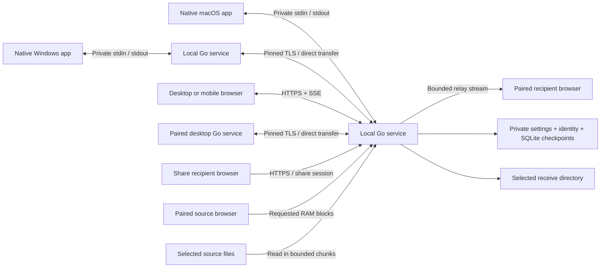

# Architecture

AirLink 0.7 simplifies desktop sending and extends the native Windows interface with Quick Share, explicit clipboard controls and attention notifications. The shared service retains failure recovery, source identity, optional organization, browser relay, aggregate payload limits, history/statistics, Quick Share and explicit clipboard text. Native and browser interfaces use the same local host. Runtime resources are bundled; no hosted signaling service, external relay, account, or online asset server is required. Feature additions are specified in [API-0.2.md](API-0.2.md), [API-0.3.md](API-0.3.md), and [API-0.4.md](API-0.4.md).

## Transfer engine

`internal/engine` owns transfer state and file I/O. Manifests identify relative file paths, sizes, timestamps, directory entries, and file IDs. Byte counts and offsets use signed 64-bit integers. Data moves in 8 MiB chunks, with a shorter final chunk when necessary.

Each uploaded chunk carries a SHA-256 checksum. Confirmed chunks and transfer metadata are persisted in SQLite with WAL and full synchronization. Retransmitted confirmed chunks are idempotent; unapproved, out-of-order, changed, or inconsistent data is rejected. Startup recovery reconciles file data with confirmed checkpoints rather than trusting a sender's local progress estimate.

Incoming files remain partial until the receiver verifies the complete file. Publication uses an atomic operation that refuses to overwrite an existing destination. Relative path validation and filesystem-root operations constrain received content to its destination. Source manifests reference original files and verify their identity before reuse; sending does not move or replace them.

New desktop outgoing references capture filesystem identity (device/inode on Unix; volume/file index on Windows), size, and nanosecond modification time before payload use. Opens and native chunk reads validate that anchor. Full source SHA-256 values persist; cached hashes are reusable only with the same anchored source. Historical records with a cached checksum but no identity are lazily streamed and compared against that checksum before anchoring and serving. Historical records with neither checksum nor identity have no earlier content proof: they validate saved size/time, acquire an identity on first use, and compute a full checksum when required. No full-library startup hash or whole-file payload staging is added.

Source hashing is cancellable, and pause/cancel/close invalidate its active operation. Original sources must remain unchanged. Filesystem identity and metadata do not establish a frozen snapshot or detect every deliberate in-place edit with forged original size/time; receiver full-file verification remains necessary before publication.

The queue has independent pools of two incoming and two outgoing transfers. Verification counts against its direction's pool. This avoids a deadlock when both hosts have incoming offers waiting for each other's outgoing queues. Chunk I/O is additionally bounded to two incoming requests. Browser relay has its own two-file-stream bound and separate metadata, so a relay is not duplicated as a stored direct transfer.

## Optional incoming-file organization

The engine snapshots `Settings.organization` for every new incoming offer. Duplicate detection and sorting both default false, with an empty rule list, including migration from older settings. A disabled or older configuration does not silently acquire sorting rules. Explicit example presets are editable UI drafts. Sorting uses ordered normalized extensions and safe relative destination folders; the first matching rule wins.

Only top-level individual source files are classified. A transferred folder and its descendants retain their hierarchy, including mixed offers containing both folders and individual files. Destinations are checked for unsafe components, symlinks, parent/file conflicts and case collisions before receiving. For new direct receives, the chosen destination is shared by transfers, so top-level name reservations and collision-safe mappings remain scoped to each persisted transfer; publication refuses replacement. A sent folder receives one unique top-level name and is never merged into a pre-existing user folder. Changing settings affects future offers only; it does not relocate active, resumed or completed data.

`File.path` stays the immutable wire name used by the sender and file IDs. `File.destinationPath` records the private relative host mapping inside its saved receive root, falling back to `path` for historical records. New direct receives publish under the chosen folder; legacy records retain their old per-transfer root. Partial payloads are private and transfer-scoped rather than visible final files. Receive, recovery, verification, publication and eligible share creation must use that mapping consistently. Guest/peer DTOs omit destination mappings and duplicate candidate identities/paths. Only private host control resolves decisions or reveals an existing candidate path.

The duplicate index covers AirLink-managed verified received files; it is not a general filesystem/library scan. Eligible existing completed incoming records can populate it, and its persistence is independent of clearing transfer history. Candidate lookup uses size and full SHA-256, then streams and revalidates the actual indexed file before exposing an actionable match. Missing, changed, replaced or symlink candidates are invalidated. An explicit Skip rechecks the chosen candidate again; filename equality alone never establishes a duplicate. These hashes use bounded buffers, without loading or copying a whole file into RAM.

Updated sources persist their existing worker checksums and call `prepare` before payload. `checkingDuplicate` represents candidate validation outside the global engine lock; `waitingDuplicate` requires a host decision and releases receive scheduling capacity. Pause/cancel and request generations prevent a stale hash result or decision from reviving interrupted work. Source SSE processing must preserve an active checking request, and a pending decision must not become a repeated chunk-upload 409 loop.

Host Keep receives a separate new file at the planned destination. Host Skip marks the incoming entry skipped/completed without copying the existing file, redirecting a download to it, or creating a placeholder payload. Original sources and indexed received files are not automatically deleted, overwritten, renamed or moved. Existing directory structure may remain. If a legacy sender already supplied and verified staging data, explicit Skip may remove only that transfer's private staging file.

Legacy sources can omit `prepare`. Complete still verifies the full file, but returns HTTP 409 while duplicate checking or a host decision remains pending; it never reports completion before publication or Skip. Keep can publish already-verified staging in the background after the sender disconnects. Private `duplicate.resolve` work is bounded to two concurrent checks and may reply out of request order; consumers correlate request IDs. Long hash checks have no fixed client timeout, and status/pause/cancel remain responsive.

`completedBytes` counts actual confirmed data. `skippedBytes` counts the avoided remainder (`size - received`), including the mixed case where a legacy sender transmitted a prefix before Skip. Progress uses their sum; skipped-file/avoided-byte statistics never inflate confirmed or lifetime traffic totals. Skipped entries have no new file to open. Direct downloads, archives and shares exclude them; an all-skipped transfer cannot create a file share. Relay payloads and browser-managed destination files are outside this organization subsystem.

## Browser relay

`internal/relay` persists immutable manifests, acceptance/state, confirmed block hashes, and delivered byte-range metadata. Payload blocks stay in bounded RAM only; the host never writes a complete relay source or destination file. At most two active relay file streams request 8 MiB blocks, with a shorter final block. This bound is not a claim about total process RSS: HTTP, hashing, runtime, and metadata allocations remain separate.

Both browsers pair with the same host. A separate `canRelay` permission defaults false for existing and new devices. The sender also needs `canSend`; the receiver needs `canReceive`. Only authorized online browser peers appear in a guest's relay choices, exposing names/IDs rather than addresses or credentials. The recipient explicitly accepts each new offer. The host may pause/resume/cancel but does not auto-accept for a guest; resuming cannot bypass acceptance. Permission changes and revocation interrupt affected activity.

The source hashes each file before the immutable offer and answers unpredictable receiver-driven requests for a specific file/chunk. Unsolicited, stale, wrong-owner, or changed confirmed blocks are rejected. Chunk acknowledgments describe consumption by the receiver transport. A normal full stream verifies the complete digest before releasing its final bytes; partial ranges validate blocks/source identity without asserting a whole saved file.

HEAD and invalid ranges do not request source bytes or advance delivery. Individual downloads support a stable ETag and a single Range; ZIP64 preserves path structure/empty directories with no archive-resume promise. `delivered` means all relevant byte ranges reached the browser transport, not that its download manager saved or verified the filesystem copy.

After host/tab/network interruption, metadata survives but buffered data does not. Both tabs must return, source file access may need reselection, and the receiver may need to resume/restart its download. No fallback silently stages a complete file on the host.

## Payload limits and history

`internal/traffic` applies independent shared token buckets for host send and receive payloads. The persisted setting is zero for unlimited, otherwise 1,024 through 1 TiB/s. Normal file transfers, public share payloads, and relay I/O use the same directional budget. Payload metering excludes control and HTTP error response bodies. Share policy/source checks run after throttling waits and before output so a limit cannot defer delivery past expiry/revocation checks.

Lifetime host payload counters persist separately from history and survive history clearing. Confirmed direct-file bytes, skipped files/avoided bytes, unique relayed transport bytes, and relay-delivery counts remain distinct. Avoided bytes never increase payload traffic counters. Guest statistics are computed only from owned/participant records and omit host-wide traffic counters.

History combines transfer and relay records newest first, with case-insensitive filename/device search and state/direction/device filters; the combined result limit defaults to 100 and is capped at 500. Clear removes terminal metadata only. Host control may clear all terminal records; a guest removes only its own terminal association, preserving the other relay participant's history. Originals, received files, active work, shares, and clipboard messages are not deleted.

Statistics describe the remaining history. Daily groups put each record's accumulated bytes/counts under its latest activity date in UTC (falling back to creation if unavailable); they are not actual per-day byte deltas. Resuming an old record can move its accumulated history total to a later day. Clearing history can reduce these summaries while lifetime payload counters remain unchanged.

## Service and trust

`internal/server` provides the HTTPS API, SSE status events, pairing, discovery, outgoing desktop transfers, and private local control. The wire protocol is documented in [API.md](API.md).

- **LAN transfer endpoint:** TLS 1.3, device authentication, same-origin/Host checks, and authorization for each transfer. Browser responses expose only that device's authorized transfer data.
- **Certificate bootstrap endpoint:** a separate HTTP listener serving public certificate material and setup instructions. It grants no access to transfer or administrator functions. The user compares its fingerprint with the local host display before trusting the certificate.
- **Local administrator console:** loopback only, protected by a per-run secret setup URL. Native macOS and Windows control uses JSON-lines stdin/stdout instead of exposing administrative powers on the LAN.

Each host keeps a local CA identity and issues a server certificate covering its local addresses. Desktop pairing pins the CA fingerprint and still verifies the certificate chain, hostname, expiry, and intended use. Discovery advertises presence through `_airlink._tcp`; discovered identity information must be confirmed out of band before pairing. Browsing uses fresh 15-second windows because the zeroconf library deduplicates entries for the lifetime of one browser. Nearby entries expire after 45 seconds. Paired trust stays in the persistent store, independently of the expiring presence hints; a refreshed advertisement can update a paired address only for the saved matching fingerprint.

Browser sessions use Secure, HttpOnly, SameSite cookies. A browser's pairing request grants no access until approved locally. Device send/receive rights and auto-accept are independently managed; revocation invalidates future authenticated access and cancels associated active work.

The 0.6 trusted pairing/accept commands are explicit private host actions. Ordinary pairing and ordinary acceptance keep the existing auto-receive setting. Trusted pairing saves a local auto-receive flag only when the pairing completes successfully; the remote host chooses its own independent policy. Trusted transfer acceptance checks that the sender remains paired and authorized while accepting, then persists only that sender's auto-receive flag. If that final save fails, the transfer remains accepted and the error states that future automatic receipt was not saved. A stale or revoked device cannot regain access through this command.

Active transfer HTTP requests carry cancellation tied to their transfer and device. Pause/cancel, access revocation, and removal of a relevant send/receive right stop affected request-body reads and response writes, including operations waiting on a directional payload limit. Checkpoints remain authoritative after interruption; a client-side cancel signal alone does not count as confirmed transferred data.

## Quick Share

`internal/shares` stores share policy, ownership, original source references, and download-session state in a separate SQLite database. Local administration can capture selected original paths or an eligible existing transfer. A paired browser may supply only its own completed received transfer; it cannot choose arbitrary host paths or manage another device's shares. Organized received transfers use their private destination mapping while retaining public relative wire names. Skipped payloads are omitted, and an all-skipped transfer cannot produce a file share or expose its existing duplicate candidate. Source identity, size, and modification time are checked before serving and during active reads. Mismatches or unavailable originals fail without staging a whole-file copy. This is not a frozen content snapshot or a promise to detect arbitrary same-file writes that preserve all checked metadata; shared originals must remain unchanged.

Links use `https://HOST/s/ID#SECRET`. The recipient app reads the fragment into session-scoped storage and removes it from the visible address. Unlock sends the secret and optional password over HTTPS; the secret never becomes an HTTP URL or referrer. Public pages disclose no filenames before successful authorization. The anonymous grant is read-only and limited to one share, independent of device pairing and local administrator privileges.

Optional passwords are hashed with Argon2id. Unlock attempts and concurrent password derivation are bounded. A successful unlock establishes a Secure, HttpOnly, SameSite share-scoped cookie; it does not consume download quota. The first successful body write atomically claims one session allowance. Additional files, Range requests, and retries in that session reuse the allowance; HEAD and invalid ranges do not consume it. Session counters and share ownership persist across restart. Private owner status can reconstruct the link, while anonymous status never returns the secret.

UI defaults are a 24-hour expiry, no password, and unlimited downloads. The service supports no expiry and explicit maximum downloads. Revocation is persistent; both revocation and expiry are checked during streaming to stop further output. A new share does not bypass host certificate trust or expose an internet-accessible relay. Individual downloads support Range, while ZIP64 downloads are streamed without resumable archive support.

Recipient lifetime decisions use host responses rather than the recipient's clock. A successful authorized metadata response remains usable even when the client clock is ahead; HTTP 410, removal, or explicit revoked metadata closes the view and stops polling. Local display of an expiry timestamp does not override host authorization. An already counted download session can still use its remaining authorized file/Range requests when the share's session limit has been reached.

## Clipboard text

Clipboard is an explicit message exchange, not background synchronization. Each paired device has a separate `canClipboard` permission, defaulting to false when the field is absent from an older saved record. File permissions do not grant clipboard permission. Desktop-to-desktop messages travel through the pinned TLS API and require both hosts to enable the permission; local success is recorded after the remote AirLink service acknowledges acceptance.

Text must be valid UTF-8 with 1–65,536 bytes. The service keeps at most 100 recent messages in process memory, removes messages older than one hour, clears them on shutdown, and removes a device's messages on revocation. Text is never written to the application databases or automatic transfer history. An explicit Copy action writes the selected text to the operating system clipboard; arrival alone never reads or replaces it.

Native and browser UI provide Paste, editable text, Send, preview, Copy, and Dismiss. The native clipboard feature reads `NSPasteboard.general` only from Paste and writes it only from a user-selected Copy action. Browsers without the clipboard API retain selectable text and manual paste. Device-scoped API filtering prevents one browser from reading another pairing's messages.

## Native macOS interface

The Swift package in `macos/` separates Codable protocol models and subprocess transport from SwiftUI/AppKit presentation. The app launches its bundled Go helper with private pipes, polls status once per second, and sends local control commands through correlated JSON-lines requests. Status refresh is serialized, and a single asynchronous reader preserves response byte order.

The app remains available in the menu bar after window closure. The menu and quit warning include active host relays as well as direct transfers. Explicit quit awaits helper checkpoint/process cleanup. File selection, drag-and-drop, and user-invoked Finder Services provide source URLs, with a legacy filename-list fallback; the helper handles the transfer. Login startup uses `SMAppService`. Status is read again when Settings opens or the app becomes active, using a user-action binding so refresh never registers/unregisters a login item. Notification authorization is requested only after a user action.

Failed-helper recovery is explicit: Retry starts the same bundled helper against the same Application Support data directory after bounded cleanup. A separate Choose receive folder and retry action supplies `--receive-dir` only after the user selects a replacement for an invalid or unavailable saved destination. There is no automatic Downloads fallback; existing incoming transfer destinations remain unchanged. The last decoded snapshot may stay visible, but helper-dependent actions require a fresh live status. Retry does not automatically focus or open a window.

Every helper session has an identifier, so an old reader, termination callback, or late reply cannot mutate the current session. Shutdown proceeds through bounded graceful, termination, and final kill stages. The app does not report a clean exit if the OS still identifies the helper as running; it reports failure and keeps the app available. Background transport tests and compilation remain separate from manual window/menu/login acceptance.

Compact share/clipboard sheets remain, with new history/statistics and relay oversight sheets. Shares need no paired target; the host relay view has no recipient-accept button. Additive Codable fields tolerate older status/device/settings fixtures, including false relay permission, unlimited rates, and the migrated enabled ⇧⌘L shortcut unless an explicit disabled setting exists. Version labels come from helper status or app bundle.

Shortcut settings persist Carbon key codes/modifier bits (default key code 37, modifiers 768). The Settings recorder receives local key events only while explicitly focused; no global keystroke monitor is installed. Command or Control is required, with optional Shift/Option. The current hotkey is suspended during capture and restored afterward. A replacement is registered before the old registration is removed; failure keeps the working registration, shows the actual registration state, and rolls back the conflicting preference. Quitting unregisters the hotkey and event handler. These paths compile and have pure model tests; actual OS registration/conflicts, Finder interaction, and login startup have not been exercised through a native GUI session.

The macOS app icon consists of written SVG layers and `AppIcon.icon/icon.json`. Icon Composer renders appearance variants headlessly; `actool` produces compiled icon assets and an older-system `.icns` fallback. No image generator is part of this process.

## Native setup and receive destinations

`Settings.setupCompleted` is an additive persisted local setting. The native wizard confirms a recognizable name and a receive folder before enabling the ordinary native send flow. Cancelling the wizard or failing its save does not complete it. New setup normally suggests the user's Downloads folder. The Windows UI uses the real Shell-known Downloads path, including redirection. An older conventional AirLink subfolder is a proposed change that requires confirmation; existing custom folders remain selected. Setup does not grant new pairing or automatic-receive rights. The CLI/web protocol continues to use its established permission rules.

New incoming records publish directly in their saved chosen root after verification. Collisions allocate a new filename such as `report (2).pdf`; a transferred directory reserves one new top-level name while preserving descendants and empty directories. Private partial payloads remain owned by the transfer. Old active/completed records retain their saved roots and are not moved when the default changes. Actual filesystem concurrency, redirection and platform behavior require the acceptance records in TESTING / DEVICE-CHECK.

## Native Windows interface

The code-only WPF application in `windows/AirLink.Windows` uses .NET 10. Self-contained x64 and ARM64 publishes bundle the runtime and the architecture-matching Go helper in a GUI executable. The app starts that helper with `CreateNoWindow` and redirected private pipes; it does not embed a browser or open a terminal for normal transfers.

`AirLink.Core` separates typed protocol data, helper extraction and subprocess transport from presentation. Extraction computes the embedded helper's SHA-256 and verifies the versioned, architecture-specific Local AppData cache before reuse; a corrupt cached helper is replaced atomically. The helper keeps persistent state in the same `%APPDATA%\AirLink` directory used by older console packages. A directory lock prevents concurrent ownership, so a running legacy console needs one explicit stop before the native app starts. Neither migration nor retry resets identity, trust or received files.

The transport serializes writes, correlates replies by request/session ID, bounds redacted diagnostic output, and uses bounded owned-process shutdown. A helper session's EOF, invalid protocol output, or unexpected exit invalidates that session; a recoverable ordinary command error does not pretend that the process has exited. The UI retains in-flight file-selection identities so a Send acknowledgment removes only the submitted selection, preserving files added while the offer was being created.

The 0.8 Windows interface uses a 320-pixel default device sidebar, resizable between 280 and 480 pixels, with two-line device names and full-name tooltips. Devices, Transfers and Settings are distinct navigation destinations. The send page concentrates on one recipient, a file drop surface and actual transfer results; permissions are in the device menu, and Quick Share / Clipboard are under More tools. The Settings page edits local name, destination, appearance, language and notifications, while advanced settings retain rates and duplicate detection. The setup window persists its decisions only through explicit successful completion. `TransferDraft` owns selection-entry identities and one immutable submission snapshot. Direct drops use only their explicit batch, keeping unrelated prepared entries; successful acknowledgments remove only submitted identities, while failed offers retain them for retry. Later source additions/reselections and later recipient choices do not mutate an in-flight offer. Private `offer` requests optionally carry a 32-character hexadecimal key saved atomically with the transfer. An identical device/ordered-path retry returns the original transfer, even after service restart; conflicting payloads fail. Native retry caching reuses this key only for unchanged entry identities and recipient, while local attempt identities still isolate late callbacks. An explicit new send gets a new key; unsubmitted GUI drafts are not persisted by this mechanism. The replay key belongs to its transfer record and is removed if that terminal history is explicitly cleared. Busy direct submissions are rejected rather than silently redirected or merged.

A sole online paired engine with receive permission can become the default only when no recipient is shown and no pending or active draft exists. An explicitly selected offline engine may receive a persistent queued offer. Native direct-send UI excludes browser peers, whose download/relay roles remain separate. Dropping onto a device or choosing files from a recipient-bound picker is the send action; an unaddressed selection stays staged for a later explicit Send.

Closing the window leaves the helper available; explicit Quit stops it. `DesktopNoticeTracker` tracks pairing, incoming offers, duplicate decisions, text and newly completed receives across status polls, without replaying historical completions or copying text to the system clipboard. Notification observation continues when disabled so re-enabling does not replay old attention. User-action errors and service errors have separate state: a successful status poll does not erase a failed user action. Active work and recent terminal results have separate panels.

Quick Share and clipboard dialogs call the existing private methods, preserve source originals and require explicit system-clipboard actions. The native window still lacks browser-relay administration, detailed statistics and sorting-rule editing. Typed settings preserve unrelated/unknown fields when updating a subset.

Both desktop interfaces request `transfer.received` only for explicit completed-receive reveal actions. The engine resolves published paths against that transfer's original receive root and destination mappings, rejecting traversal/symlink paths and omitting missing/skipped entries. An explicit transferred folder covers its children in the top-level result. An empty transferred folder is a result; an all-skipped regular-file offer is not. Explorer/Finder opens only after a user action. Empty owned `.airlink-partials` directories are removed after newly committed completion with a nonrecursive removal; nonempty, unknown, symlink or historical folders are never recursively cleaned by a reveal query.

Pairing acknowledgment leaves the native interface waiting for remote approval. An unchecked auto-receive choice controls receipt on the current computer only. A discovered address/fingerprint is a draft; direct comparison at the other computer remains required. Compilation, PE GUI/icon inspection and background core/helper tests do not prove actual Windows dialogs, tray, Explorer or notifications; those require manual Windows acceptance.

## Browser interface

The React/TypeScript interface in `web/` is compiled into static assets embedded in the Go binary. A worker performs incremental SHA-256 hashing with bounded input blocks. IndexedDB stores resume manifests and integrity evidence; browser memory retains source `File` objects while access remains available.

Pairing request state always survives in memory for the current page. Session storage provides optional reload recovery; denied storage property access, reads, writes, or removal must not prevent polling or completing an approved pairing. This is separate from the upload manifest requirement: a new upload must save its IndexedDB integrity evidence before sending payload or cancel the new offer.

Source path validation mirrors the engine's conservative portable names before hashing or offer creation. A literal backslash is rejected instead of converted into a separator. Control characters, reserved Windows names, unsupported punctuation, unsafe/traversal components, trailing dots/spaces, direct case collisions, and files occupying a parent directory are rejected with actionable localized errors. Original Unicode spelling is retained; the browser does not invent normalization or silently rename selected files.

For desktop receives, the source calls file preparation after hashing and before uploading. A 404 from an older host falls back only after refreshing the owned transfer. Pending duplicate checks/decisions show host attention without guest resolution controls; Keep resumes with saved checksums, while Skip requires no payload-completion request. Reconnection reconciles the host's confirmed offsets. After reload or loss of file access, the user selects the same unchanged sources again. This requirement avoids pretending that every browser grants persistent filesystem access.

Individual downloads use HTTP Range/ETag support; ZIP64 folder downloads stream without a resumable-archive promise. The browser download manager owns saving and completion reporting. A download initiation acknowledgment is never treated as proof of saved or integrity-verified bytes on the client.

Paired browsers use the connected host for direct uploads/downloads or for authorized browser-to-browser relay. Anonymous share recipients use a separate route without device pairing. Both modes retain the certificate onboarding and browser file-access/download-manager limits.

## Persistence and packaging

Host settings, identity, and device records live in a private OS-specific AirLink configuration directory; SQLite stores transfer/relay metadata, the independent managed verified-file duplicate index, and durable share/session data, while traffic counters persist separately. Authorized share owners can recover links after restart, so link secrets remain private local application data. Relay payload blocks and clipboard messages are deliberately excluded from persistence. Received files live separately in the selected destination. A data-directory lock prevents two services from operating on the same local state concurrently.

The build pipeline compiles the web interface, embeds it, and cross-compiles portable Go services. On macOS it creates a universal native app with a universal helper and the compiled icon. The Windows publish embeds each matching helper in a self-contained WPF GUI executable; its written icon follows the same linked-arcs motif. Packaging creates direct native Windows EXE downloads, Linux service archives, a macOS DMG, and checksums. The Windows assembly embeds the MIT license and resolved runtime notices, displayed by the Settings license pane. A headless PE/metadata inspection validates the managed assembly version, matching helper digest, licenses/notices and icon without loading WPF; the GUI apphost is checked separately. App replacement must preserve the separate state and receive directories.

Version 0.8 is a private setup/usability preview; final verification and artifact evidence belong in [TESTING.md](TESTING.md). Historical verification remains version-specific. The private macOS signing policy remains ad hoc. Developer ID signing, notarization, physical cross-device acceptance, and public distribution remain separate delivery gates, defined in [RELEASE-READINESS.md](RELEASE-READINESS.md).
