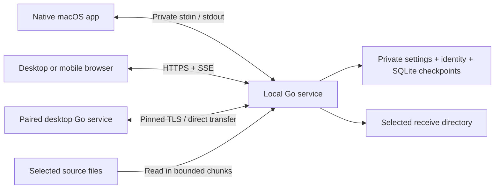

# Architecture

AirLink 0.1 uses a shared local transfer service with native and browser interfaces. Runtime resources are bundled; no hosted signaling service, external relay, account, or online asset server is required.

## Transfer engine

`internal/engine` owns transfer state and file I/O. Manifests identify relative file paths, sizes, timestamps, directory entries, and file IDs. Byte counts and offsets use signed 64-bit integers. Data moves in 8 MiB chunks, with a shorter final chunk when necessary.

Each uploaded chunk carries a SHA-256 checksum. Confirmed chunks and transfer metadata are persisted in SQLite with WAL and full synchronization. Retransmitted confirmed chunks are idempotent; unapproved, out-of-order, changed, or inconsistent data is rejected. Startup recovery reconciles file data with confirmed checkpoints rather than trusting a sender's local progress estimate.

Incoming files remain partial until the receiver verifies the complete file. Publication uses an atomic operation that refuses to overwrite an existing destination. Relative path validation and filesystem-root operations constrain received content to its destination. Source manifests reference original files and verify their identity before reuse; sending does not move or replace them.

The queue has independent pools of two incoming and two outgoing transfers. Verification counts against its direction's pool. This avoids a deadlock when both hosts have incoming offers waiting for each other's outgoing queues. Chunk I/O is additionally bounded to two incoming requests. Durable transfer records also provide the current local transfer list; expanded history and analytics are later milestones.

## Service and trust

`internal/server` provides the HTTPS API, SSE status events, pairing, discovery, outgoing desktop transfers, and private local control. The wire protocol is documented in [API.md](API.md).

- **LAN transfer endpoint:** TLS 1.3, device authentication, same-origin/Host checks, and authorization for each transfer. Browser responses expose only that device's authorized transfer data.
- **Certificate bootstrap endpoint:** a separate HTTP listener serving public certificate material and setup instructions. It grants no access to transfer or administrator functions. The user compares its fingerprint with the local host display before trusting the certificate.
- **Local administrator console:** loopback only, protected by a per-run secret setup URL. Native macOS control uses JSON-lines stdin/stdout instead of exposing administrative powers on the LAN.

Each host keeps a local CA identity and issues a server certificate covering its local addresses. Desktop pairing pins the CA fingerprint and still verifies the certificate chain, hostname, expiry, and intended use. Discovery advertises presence through `_airlink._tcp`; discovered identity information must be confirmed out of band before pairing.

Browser sessions use Secure, HttpOnly, SameSite cookies. A browser's pairing request grants no access until approved locally. Device send/receive rights and auto-accept are independently managed; revocation invalidates future authenticated access and cancels associated active work.

## Native macOS interface

The Swift package in `macos/` separates Codable protocol models and subprocess transport from SwiftUI/AppKit presentation. The app launches its bundled Go helper with private pipes, polls status once per second, and sends local control commands through correlated JSON-lines requests. Status refresh is serialized, and a single asynchronous reader preserves response byte order.

The app remains available in the menu bar after window closure. Explicit quit checkpoints and stops the helper. File selection, drag-and-drop, and Finder Services provide source URLs; the helper handles the transfer. Login startup uses `SMAppService`. Notification authorization is requested only after a user action. The global send shortcut is currently fixed to ⇧⌘L.

The app icon consists of written SVG layers and `AppIcon.icon/icon.json`. Icon Composer renders appearance variants headlessly; `actool` produces compiled icon assets and an older-system `.icns` fallback. No image generator is part of this process.

## Browser interface

The React/TypeScript interface in `web/` is compiled into static assets embedded in the Go binary. A worker performs incremental SHA-256 hashing with bounded input blocks. IndexedDB stores resume manifests and integrity evidence; browser memory retains source `File` objects while access remains available.

Reconnection reconciles the host's confirmed offsets. After reload or loss of file access, the user selects the same unchanged sources again. This requirement avoids pretending that every browser grants persistent filesystem access.

Individual downloads use HTTP Range/ETag support; ZIP64 folder downloads stream without a resumable-archive promise. The browser download manager owns saving and completion reporting. A download initiation acknowledgment is never treated as proof of saved or integrity-verified bytes on the client.

In 0.1 a browser connects to one desktop host. A local browser-to-browser relay is planned for 0.3.

## Persistence and packaging

Host settings, identity, and device records live in a private OS-specific AirLink configuration directory; SQLite stores transfer checkpoints. Received files live separately in the selected destination. A data-directory lock prevents two services from operating on the same local state concurrently.

The build pipeline compiles the web interface, embeds it, and cross-compiles portable Go services. On macOS it creates a universal native app with a universal helper and the compiled icon. Packaging creates platform archives, a DMG, and checksums. App replacement must preserve the separate state and receive directories.

The current private macOS build uses ad hoc signing. Developer ID signing, notarization, physical cross-device acceptance, and public distribution remain separate delivery gates.
